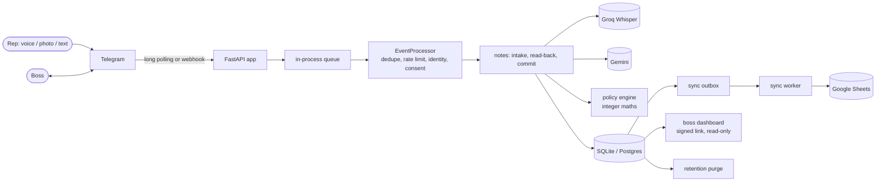
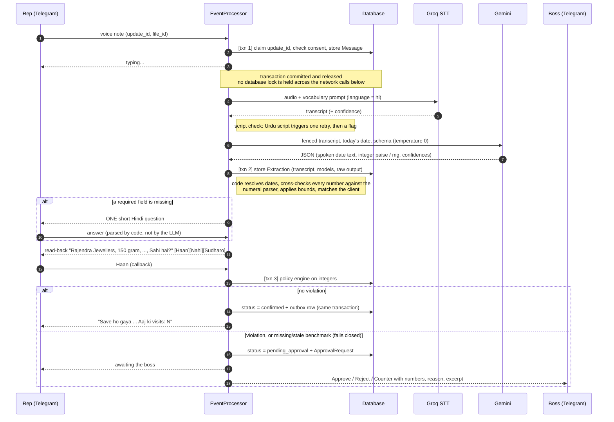

# Architecture

BharatDesk turns a field rep's voice note, photo of a slip, or typed message into a **verified
record**, enforces the owner's pricing policy, and lets the owner approve exceptions with one tap.

> **LLMs EXTRACT; CODE DECIDES.** A model converts speech or an image into a schema-validated
> payload. Everything that touches money, dates, policy, approvals and tenant boundaries is
> deterministic Python with tests. No model output is ever executed, trusted as a number without a
> cross-check, or allowed to change a rule.

## Components



| Area | Where | Notes |
|---|---|---|
| Transport | `app/bot/webhook.py`, `polling.py`, `providers/messaging.py` | aiogram client behind a `MessagingProvider`; `FakeProvider` for tests and the sandbox |
| Event pipeline | `app/bot/processor.py` | one transaction per event; replies are sent only after commit |
| Note flow | `app/bot/notes.py` | intake, deferred slow work, read-back, slot filling, corrections |
| Extraction | `app/pipeline/extract.py`, `slip.py`, `assess.py` | strict schemas, retry once, then code-side checks |
| Numbers and dates | `pipeline/numerals.py`, `dates.py`, `app/units.py` | Hindi/English/Devanagari parser, exact `Fraction`s, integer paise and mg |
| Policy | `pipeline/policy_engine.py`, `schemas/policy.py` | four rule types, basis points, fails closed |
| Commit and approvals | `pipeline/commit.py`, `services/approvals.py`, `bot/approvals_ui.py` | compare-and-set resolution, counter, expiry, reminders |
| Sheets | `services/sync_queue.py`, `sheets_sync.py`, `providers/sheets.py` | transactional outbox, retry with backoff |
| Dashboard | `app/web/dashboard.py` | signed expiring link, cookie session, one write action |
| Operations | `services/retention.py`, `worker_data.py`, `pilot_report.py`, `scripts/` | purge, export/erase, evidence |

## Sequence: a voice note becomes a record



## Sequence: approval, sync and expiry

```mermaid
sequenceDiagram
    autonumber
    participant B as Boss
    participant P as EventProcessor
    participant DB as Database
    participant W as Sync worker
    participant G as Google Sheets
    participant R as Rep

    B->>P: Approve (callback id)
    P->>DB: UPDATE approval SET status = approved WHERE status = pending (compare-and-set)
    alt rowcount = 1
        P->>DB: activity = confirmed, audit row, outbox row (one transaction)
        P-->>R: "Boss ne approve kar diya"
    else already resolved (double tap)
        P-->>B: no-op toast
    end
    loop every few seconds
        W->>DB: due jobs; re-check status is confirmed
        W->>G: upsert row keyed by record id (no database lock held)
        alt success
            W->>DB: job done, activity = synced
        else failure
            W->>DB: attempts + 1, next try after 30 s, 60 s, 120 s ... up to 1 h
        end
    end
    Note over P,R: after 24 h unresolved: expired, rep and boss told,<br/>record stays rejected and is never synced; boss reminded once at 12 h
```

## Invariants the code relies on

1. **Money is integer paise; weight is integer milligrams.** Pydantic strict ints at every boundary,
   `Fraction` for Hindi fractional words, no float/`round`/`/` in money modules (an AST test enforces it).
2. **Every external value is read back** unless auto-confirm is enabled **and** confidence, bounds,
   the numerals cross-check and an exact client match all agree.
3. **One tenant-scoped repository** (`TenantRepository`) is the only way handlers read or write
   tenant data; a static test fails if other modules query directly. Tenant A cannot read tenant B.
4. **Idempotency everywhere:** updates and callbacks are claimed once; approvals resolve by
   compare-and-set; sync rows are keyed by record id; duplicate photos are rejected by hash.
5. **Append-only audit log**, enforced by an ORM guard and SQLite triggers.
6. **Slow work never holds a lock.** Network calls run after the intake transaction commits.
7. **Untrusted input is data.** Transcripts, slip text and chat messages never change a role, a rule
   or a rate; they are fenced in prompts and rendered escaped.

## Trade-offs (chosen / rejected / why)

| Decision | Rejected | Why |
|---|---|---|
| SQLite default, Postgres-compatible models, `BEGIN IMMEDIATE` | Postgres from day one | A pilot of 3-10 reps needs zero infrastructure; SQLite serialises writers, which is fine at this scale. Move to Postgres to scale. |
| In-process asyncio queue, one worker | Redis/Celery | No new moving parts; per-chat ordering for free. Cost: a crash can strand a note in `processing`; a sweep gives up on it after 10 minutes and the rep resends. |
| Transactional outbox for Sheets | Calling Sheets in the reply path | Replies never wait on Google; a crash cannot lose a confirmed record. |
| Code-resolved dates and cross-checked numbers | Trusting the LLM's arithmetic | Hindi number words and "kal" are exactly where models slip. |
| Dossier from a template over saved rows | LLM-written summary | It cannot invent a visit or an amount. |
| Auto-confirm off by default | On with a threshold | There is no eval data yet to justify skipping the read-back. |
| Counter limited to rate / discount | Free-form counters | Those two have an unambiguous effect on a stored number. |

## Failure modes

| Failure | Behaviour |
|---|---|
| Speech provider down or rejects the file | rep told to resend or type; Message marked failed; ffmpeg fallback if Groq rejects OGG/Opus |
| LLM returns invalid JSON or a float amount | one retry with the validation error, then "please resend" |
| Doubtful audio, number disagrees with transcript, value out of bounds | forced read-back with a warning naming the fields |
| Benchmark missing, stale or in another unit | policy fails closed: boss approval required |
| Boss never Started the bot | request held; rep told clearly |
| Sheets unreachable | retries with backoff; after 8 attempts the boss is told once; the record stays safely stored |
| Process crash mid-note | transaction rolled back (retry reprocesses); a note past intake is marked failed by the recovery sweep after 10 minutes and the rep is told to resend |

## Scaling notes

Single process, single worker. The first steps to scale are Postgres, a real queue with per-chat
ordering, and splitting the sync worker. Nothing in the data model prevents it.
